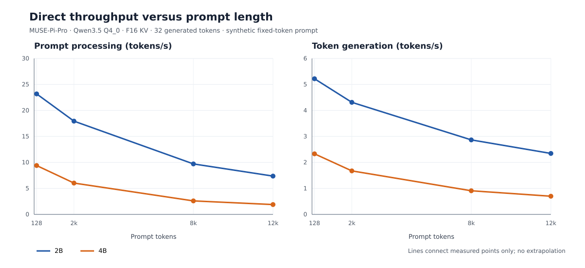

# Qwen3.5 2B/4B inference lifecycle on MUSE-Pi-Pro

> Dated campaign snapshot. The measurements apply to the stated workload and
> date. Queued/running statements below are historical. Use the
> [current guide](../DOCS.md) and the [reports index](README.md) for later
> results and for the current status.

Date: 2026-09-25. Board: `musepipro-wg`, SpaceMiT K1/X60, Bianbu 2.3.5, 16 GiB
RAM. Source: the official SpaceMiT llama.cpp fork with the packaged project
patches, in the isolated integrated checkout at `a990751`. The TCM library was
first in `LD_LIBRARY_PATH`. The server log confirms `is_fake_tcm: 0` and
`use_ime1: 1`. The CPU governor was `performance`, the current frequency was
1.6 GHz, and the thermal zones were 39–41 °C during the first sweep. All eight
harts identify as X60, but only cores 0–3 advertise the IME extension. The
SpaceMiT runtime selects those four cores as its preferred `cpu_mask: f` group.

**Campaign completion audit (2026-09-27):** the
[completed board gates](2026-09-27-completed-gates.md) supersede the
queued-status statements in the chronological campaign notes below. The
integrated board checkout now contains the opt-in 256-bit RVV attention patch.
Use `SPINE_FA_WIDE_TILE=1` with these Qwen3.5 F16-KV models.

## Method

The [lifecycle runner](../bench/bench-lifecycle.py) sends a fixed token-ID
prompt through the local loopback `/completion` streaming API. Unless a row
states otherwise, the settings are: four server threads, Q4_0 weights and draft
head, flash attention, batch/ubatch 32, greedy seed 42, prompt cache disabled,
one slot, F16 K/V, and a 16,384-token context. The report gives the time to
first token (TTFT) from the client observation: the time from the request start
to the first content-bearing stream event. The prompt and decode rates come
from the final timings of the server. The runner samples `VmRSS` every
0.2 seconds, and that sample includes the model pages and the runtime buffers.
The later runs sample the system `MemAvailable` at the same interval. The
prompt IDs repeat a tokenized sentence, and this repetition holds the token
count constant. This test is a hardware stress test, not a natural-document
quality test.

## Initial direct-decoding baseline

| Model | Prompt tokens | TTFT (s) | Prompt (tok/s) | Decode (tok/s) | Peak RSS (MiB) |
| --- | ---: | ---: | ---: | ---: | ---: |
| 2B | 128 | 5.52 | 23.19 | 5.22 | 2520 |
| 2B | 2048 | 114.25 | 17.94 | 4.31 | 2580 |
| 2B | 8192 | 843.69 | 9.71 | 2.87 | 2584 |
| 2B | 12288 | 1667.24 | 7.37 | 2.34 | 2585 |
| 4B | 128 | 13.62 | 9.40 | 2.33 | 5470 |
| 4B | 2048 | 340.02 | 6.03 | 1.67 | 5626 |
| 4B | 8192 | 3158.88 | 2.59 | 0.91 | 5627 |
| 4B | 12288 | 6487.11 | 1.89 | 0.70 | 5628 |

The
[measured context curves](raw/2026-09-25-lifecycle/context-curves.svg) connect
the completed direct-decoding points through 12,288 tokens, for both models.
[plot-context-curves.py](../bench/plot-context-curves.py) generates the figure
from the archived JSONL.

The GGUF metadata reports full attention in every fourth main-model layer: six
attention layers for 2B (24 main blocks), and eight for 4B (32 main blocks).
F16 K+V therefore requires 12,288 bytes per token for 2B, and 32,768 bytes per
token for 4B. At a 16k-token cache, those values are 192 MiB and 512 MiB. That
figure is before the separate MTP draft cache and the allocator and runtime
overhead. The Q8_0 and Q4_0 cache formats can reduce this component, but the
board has 16 GiB RAM, and quantized attention can cost compute. The completed
short-context A/B results below measure that tradeoff. A repeated 4B comparison
is still necessary, before an adoption.

The following figures are tensor-payload estimates for a 16,384-token target KV
cache. They use the GGUF attention-layer counts and 32-element quantization
blocks. They exclude the allocator padding, the recurrent state, the graph
buffers, the model mappings, and any MTP draft cache. The report gives the
measured whole-process effects below.

| K/V format | Bytes per 32 values | 2B target KV | 4B target KV | Reduction versus F16 |
| --- | ---: | ---: | ---: | ---: |
| F16 | 64 | 192 MiB | 512 MiB | baseline |
| Q8_0 | 34 | 102 MiB | 272 MiB | 46.9% |
| Q4_0 | 18 | 54 MiB | 144 MiB | 71.9% |

A live
[4B F16 process snapshot](raw/2026-09-25-lifecycle/f16-4b-process-snapshot.txt)
during the 12k prefill reports `VmSize` 7,010,136 kB, `VmRSS` 5,660,016 kB, and
no swap. This observation covers the full process. It is not an isolated KV
measurement. The later cache-format records capture `VmSize` after the server
load, and also after each request, in addition to the RSS. The
[memory summary tool](../bench/summarize-memory.py) reports these
whole-process metrics side by side.

The 2B 128-token TTFT differs from the older `llama-bench pp128` metric. It
includes the actual server handling and the arrival of the first streamed
token. Across the eight completed baseline rows, the client TTFT exceeded the
server-reported `prompt_ms` by 0.004–0.309 seconds. At the measured 2k and 8k
lengths, the prefill therefore dominates the first-token latency. A reduction of
the request transport alone cannot materially change these cold-prompt results.
The 2,048-token and 8,192-token results show substantial prefill and decode
degradation, as the attention history grows. At 8k, the prompt throughput is 58%
lower, and the direct decode is 45% lower, than at 128 tokens. At 12k, those
losses reach 68% and 55%. The TTFT is 27.8 minutes for this cold synthetic
prompt. Inside the 8k request, the RSS varied by 2.75 MiB. The 31 gaps between
the 32 streamed decode events had a p99 of 374.6 ms, and no gap was over one
second. At 12k, the sampled RSS stayed exactly 2,584.65 MiB across 8,344
samples. The 31 stream-event gaps had a p99 of 448.6 ms, and none was over one
second.

The 4B 8k cold prompt took 52.65 minutes to the first token. Relative to its
128-token point, the prompt rate fell 72%, and the direct decode rate fell 61%.
The 8k request produced all 32 tokens at the limit, with matching streamed and
server counts, and with no error. The decode-phase RSS was flat across 174
samples. All 31 inter-token gaps were over one second, but they stayed tightly
clustered at 1,128–1,141 ms. The first-half and second-half stream rates were
0.882 and 0.881 tok/s. This cadence is the expected slow token rate, and it is
not evidence of an intermittent stall. These short decode samples are not proof
of long-duration stability. The completed 4B 12k cold prompt took 108.1 minutes
to the first token. Relative to 128 tokens, the prompt throughput fell 79.9%,
and the direct decode throughput fell 70.0%. All 32 tokens streamed at the
limit, with no error. The decode-phase RSS was constant across 227 samples, and
the 31 inter-token gaps stayed tightly grouped around the slow 0.70-token/s
cadence (p99 1,488.5 ms). No intermittent stall appeared. The whole-request RSS
ranged 100.5 MiB, while the pages became resident during the prefill. These
short decode samples alone do not prove long-duration stability. The analysis of
the completed 2,048-token runs is below.

## Where prefill time grows

The server progress log reports the elapsed prompt time after each 32-token
microbatch. An average of the adjacent full 32-token batches within ±256 tokens
of each context length gives:

| Model and completed request | Near 256 tokens (s/32) | Near 2k (s/32) | Near 8k (s/32) | Near 12k (s/32) |
| --- | ---: | ---: | ---: | ---: |
| 2B, 12k request | 1.46 | 2.25 | 5.41 | 7.24 |
| 4B, 8k request | 3.73 | 7.51 | 21.32 | — |
| 4B, 12k request | 3.73 | 7.49 | 21.54 | 30.68 |

The 4B batch time rose 5.7× between the 256-token and 8k neighborhoods, and it
rose 8.2× by 12k. The 2B time rose 3.7×. A source inspection found that the
SpaceMiT RVV flash-attention dispatcher accepts K/V head dimensions only up to
128, while both measured GGUFs use 256. The current F16 attention path
therefore falls back to the generic CPU attention for these heads. The isolated
[wide tiled RVV candidate](../experiments/2026-09-26-wide-rvv-fa.md) tests this
specific gap. This comparison is inside one request, so it avoids a comparison
of different server launches. But it does not isolate the operation that caused
the growth. The result makes the long-context prefill a separate optimization
target from the short-prompt batch overhead.
[summarize-prefill-chunks.py](../bench/summarize-prefill-chunks.py) and the
archived server logs reproduce the values. The 4B log is archived beside the
JSONL.

## Completed decode and scheduling comparisons

The forced 2,048-token runs finished at the token limit, with no server errors.
The direct and MTP token hashes match inside each model. The repeated synthetic
prompt yielded a 100% acceptance of the logged MTP draft tokens. That prompt is
a favorable case for speculation, and it is not evidence for arbitrary prose.
The rate decreases as the generated context grows, and the 128-token windows
make that expected drift visible.

| Model and mode | Wall time (s) | Decode (tok/s) | 128-token window min/median/max (tok/s) | Last versus first window | Decode RSS drift (MiB) | Max stream gap (ms) |
| --- | ---: | ---: | --- | ---: | ---: | ---: |
| 2B direct | 456.3 | 4.54 | 4.15 / 4.53 / 5.04 | −17.7% | +1.75 | 255 |
| 2B MTP | 269.6 | 7.76 | 6.50 / 7.64 / 9.43 | −31.0% | +5.13 | 1,020 |
| 4B direct | 1,114.7 | 1.86 | 1.61 / 1.86 / 2.24 | −28.4% | +0.50 | 636 |
| 4B MTP | 622.0 | 3.37 | 2.60 / 3.39 / 4.58 | −43.1% | +4.13 | 1,603 |

MTP raised the average decode rate by 70.8% for 2B, and by 81.1% for 4B, on
this prompt. All four long runs have 16 timing windows, and they have bounded
post-prefill RSS changes of 0.5–5.1 MiB. The larger MTP gap maxima reflect the
batched speculative delivery. The window-rate trend and the exact token count
show no unexplained stall in these single requests. The repeated-request soak
has now completed for both model sizes and both modes. The report gives its
rates, hashes, and memory below. This evidence shows bounded multi-request
stability. It is not a claim of indefinite stability. The detailed traces are in
[followup.jsonl](raw/2026-09-25-lifecycle/followup.jsonl), and
[summarize-stability.py](../bench/summarize-stability.py) reproduces them.

At 128 prompt tokens and 128 requested output tokens, 4B MTP improved the
single-request aggregate generation from 1.82 to 3.03 tok/s (+66.9%). At 2, 4,
and 8 concurrent requests, its aggregate throughput was 2.21/3.24/3.42 tok/s,
against 2.26/3.33/3.52 tok/s for direct decoding (2.1–2.6% lower). All 46
comparable 4B completions, including the unified-KV variants, shared one token
hash at this prompt and length. Single-stream speculation is beneficial here.
The initial synthetic eight-stream data does not support an enablement of
speculation at high concurrency. The completed fixed-code comparison below
found the same high-concurrency throughput direction, with output variants
across the simultaneous requests. At eight 4B streams, the shared-cell
`--kv-unified` scheduler gave 3.53 aggregate tok/s for direct decoding, and
3.43 for MTP, against 3.52 and 3.42 with the partitioned KV. The peak RSS
differed by under 6 MiB per matched mode. This equal-length case shows no
material scheduling gain. The first uneven-slot comparison is reported below.
The two-round rotated reuse comparison is active.

Full-history MTP at 12k finished with 128 tokens, for both models. Its
cold-prompt TTFT was 1,844.8 s for 2B, and 7,197.2 s for 4B, against 1,667.2 s
and 6,487.1 s for the 32-token direct baselines at the same prompt length. The
prompt throughput fell by about 10% in MTP mode, and its decode rate was only
2.64 and 0.76 tok/s at 2B/4B. At these measured prefill and decode rates, a
full-history MTP is projected to lose end-to-end latency for a cold 12k prompt
that is followed by only 128 output tokens. The direct baselines requested only
32 tokens, so these rows are not a matched long-output hash comparison. The
completed draft-window tests and the pending same-binary controls check whether
a shorter draft history changes this tradeoff.

A first 2B draft-window run at 12k has completed. With a 2,048-token draft
window, the run produced all 128 tokens, and it matched the full-history MTP
token hash. It reached 2.83 decode tok/s against 2.64 for full-history MTP, and
it peaked at 2,586 MiB RSS against 2,654 MiB. Its TTFT was 1,709 s against
1,845 s. These long arms used separate builds, so you cannot attribute the TTFT
difference to the window yet. On the same patched binary, at a 128-token
prompt, the 2B full and window arms had effectively identical TTFT and decode
rates. The windowing lowered the peak RSS by 27 MiB, and the loaded virtual
size by 23.7 MiB. The analogous 4B short arms lowered the peak RSS by 54 MiB,
and the loaded virtual size by 54.3 MiB, with no speed change. The 4B windowed
12k run also completed all 128 requested tokens. It reached 6,648.0 s TTFT,
1.85 prompt tok/s, 0.89 decode tok/s, and 5,595.0 MiB peak RSS. The earlier
full-history MTP result was 7,197.2 s, 1.71 tok/s, 0.76 tok/s, and 5,729.5 MiB.
Both sizes have a token-for-token match between the 12k windowed outputs and
the full-history MTP outputs. The 4B windowed log reports an acceptance of 95 of
95 draft tokens. These long arms used separate builds, so their apparent speed
differences remain provisional. Same-binary 12k full-history controls are
queued, and they are necessary before an adoption.

## KV compression, allocation, and warm-prefix results

The loaded-process RSS and virtual-size differences, at the same 16,384-token
allocation, closely match the metadata-based target-KV payload estimates. These
comparisons cover the whole process. They include the backend allocation
behavior, but they do not time each cache operation separately.

| Model | K/V | Loaded RSS (MiB) | RSS saved versus F16 (MiB) | Loaded VmSize (MiB) | 2k TTFT (s) | 2k decode (tok/s) |
| --- | --- | ---: | ---: | ---: | ---: | ---: |
| 2B | F16 | 2476.5 | — | 3999.8 | 114.25 | 4.31 |
| 2B | Q8_0 | 2387.2 | 89.3 | 3910.6 | 140.61 | 4.12 |
| 2B | Q4_0 | 2339.2 | 137.3 | 3862.6 | 119.51 | 4.45 |
| 4B | F16 | 5363.7 | — | 6687.3 | 340.02 | 1.67 |
| 4B | Q8_0 | 5123.8 | 239.9 | 6447.5 | 372.20 | 1.73 |
| 4B | Q4_0 | 4996.4 | 367.3 | 6319.5 | 300.99 | 1.96 |

Q4_0 K/V reduced the 4B 2k TTFT by 11.5%, and it raised the 32-token decode
rate by 17%, in this single comparison. Its token hash matched F16. The 2B 2k
TTFT increased 4.6%, despite the lower memory use. Q8_0 saved memory for both
sizes, but it increased the 2k TTFT. A repeated and interleaved 4B F16/Q4_0
comparison is queued, before a recommendation of Q4_0 as a general cold-prefill
setting. The separate 8k-versus-16k F16 allocation check measured +96.5 MiB
loaded RSS for 2B, and +256.1 MiB for 4B. Those values are consistent with
their per-token KV payload.

With an identical 2,048-token prefix, reused in one server process, the 2B
client TTFT fell from 110.87 s on the cold request to 0.45 s on the next
request. The 4B TTFT fell from 336.80 s to 1.32 s. The token hashes matched the
cold outputs. This benefit of `cache_prompt=true` is workload-specific, and it
is useful when the requests truly share a prefix. It does not improve a first
encounter with a long prompt. A change of the ubatch from 32 to 48 gave a small
4B 2k TTFT change (336.38 to 334.86 s, across two repeats), and a small 2B
regression (111.22 to 112.16 s). Those measurements justify no broad ubatch
change.

## Verification criteria

For the forced 2,048-token generation runs, a bounded stability result requires
three conditions: the server finishes at the token limit, it produces all 2,048
tokens without an error, and it shows no unexplained long stall and no growing
post-prefill RSS. The decode rate can decline while the context expands. The
report therefore gives the first-half and second-half rates, the 128-token
window rates from the saved per-event trace, and the event-gap tails. It does
not hide those values inside a single average. The repeated soak checks also
whether the RSS or the output changes across the completed requests in one
server process. For an MTP configuration, the greedy direct and MTP output
hashes must match, before that configuration can be called lossless on the
tested prompt. The project will recommend a configuration change only for an
observed end-to-end improvement on the matching workload.

## Checklist coverage and decision gates

The [completed-gates audit](2026-09-27-completed-gates.md) is the current
result. The earlier sections above, and the original plan below, retain their
measurement chronology.

| Requirement | Current board evidence | Remaining limitation |
| --- | --- | --- |
| 2B/4B TTFT and sustained prefill | Client TTFT and prefill through 12k, for both models. The activated 256-bit RVV F16 attention cut the 2k TTFT by 18.8% and 32.7%, and the 8k TTFT by 49.2% and 64.0%, for 2B/4B, in off/on/on/off runs. The integrated build and the exact-output smoke passed. | The kernel is opt-in, and it is specialized to the 256-dimensional F16 heads. There is no claim for another model or KV format. |
| Stable long generation | The repeated 2,048-token synthetic runs, and the 4,096-token C++-prompt direct/MTP runs, completed with event traces and bounded post-prefill RSS. | At 4,096 code tokens, the MTP and direct hashes differ for both models. Locate and fix the divergence, before a claim of losslessness. Finite runs do not prove indefinite stability. |
| 4B speculative concurrency | The synthetic and fixed-code c1/c4/c8 runs are measured. The pinned c4/c8 ABBA preserved the exact hashes at each physical slot. MTP was about 2–3% slower than direct at c4/c8. | Do not generalize the pinned 128-token accuracy to arbitrary prompts or to a long output. |
| Long-context degradation and memory | Both direct curves reach 12,288. The measured RSS jitter, the 8k/16k cache allocation, the KV payload estimates, the RVV 8k gain, and the 12k windowed MTP controls exist. | The quantized-KV long-output quality, and a broader prompt diversity, remain untested. |
| Windowed MTP | The 12k window and full same-binary outputs match. The draft window saved 68.5 MiB and 135.3 MiB of peak RSS, for 2B/4B. | There is only one long run per arm. Repeat the interleaved runs, before an attribution of the speed differences to the window. |
| KV cache compression | The 4B F16/Q4_0/Q4_0/F16 ABBA at 2k gave exact 32-token outputs, a 12.1% lower TTFT, and 367.6 MiB less loaded RSS. The 2B Q4_0 saved RAM, but it slowed the 2k TTFT. | Q4_0 KV prevents the measured F16-only RVV path. Select it by the speed against the memory need. The long-output quality is unverified. |
| Layered offloading | The OpenCL build and the 0/4-layer runs completed. But the backend rejected the PowerVR GPU, and it ignored `-ngl 4`. | A supported backend or port, and a benchmark of the actual transferred layers, are still necessary. |
| Paged scheduling | The occupied-page gather passed the numerical check and the 64-completion exact-output gate. But it reduced the throughput by about 2–3%, and it retained the full backing allocation. | Implement the page allocation and reclamation, and the direct mapped attention. The current gather is not full paged scheduling. |

## Original benchmark campaign plan

The following list records what was queued when the campaign began. The
[2026-09-27 audit](2026-09-27-completed-gates.md) has its completed results and
decisions.

- Direct prefill and decode curves at 128, 2,048, 8,192, and 12,288 prompt
  tokens, for both model sizes.
- 4B direct decoding against the default checkpoint and gated MTP, at 1, 2, 4,
  and 8 concurrent requests.
- A forced 2,048-token generation for both sizes, in direct and MTP mode, with
  a measurement of the token-gap tails and the rate drift.
- The gated follow-up soak completed four repeated 2,048-token requests per 2B
  mode, and two per 4B mode, in persistent server processes. The report gives
  the rates, the exact output hashes, and the memory drift above.
- F16 against Q8_0 and Q4_0 KV cache, and the 8k against 16k allocated context
  footprints.
- Ubatches 32 and 48, repeated-prefix caching, shared KV scheduling, and MTP at
  12,288 prompt tokens.
- A four-slot, uneven-length (128/512/1024/2048) ABBA comparison of the
  partitioned against the unified KV scheduling. Two request rounds per server
  follow it, and the second round rotates the slot-to-length assignment. The
  first comparison probes the active allocation. The second probes also the cell
  reuse, after the requests complete. Neither comparison is a true
  paged-attention implementation.
- An ordered direct/MTP 4B concurrency 1/4/8 comparison, on the first 128
  tokens of a fixed C++ source prompt. The comparison uses `ignore_eos`, so
  that the output lengths stay equal. It checks whether the synthetic-prompt
  concurrency result generalizes to code.
- An [opt-in 256-head RVV tiled attention candidate](../experiments/2026-09-26-wide-rvv-fa.md).
  The team builds it in an isolated worktree, and it compares off/on/on/off at
  128 and 2048 prompt tokens for both sizes, after the current campaign. The
  candidate targets the observed fallback from the SpaceMiT RVV attention to
  the generic CPU attention during the prefill.
- A gated 8k off/on/on/off extension, for each size whose short-context RVV
  arms complete at the token limit and have identical token hashes. This
  extension tests whether the 2k prefill gain persists at a long prompt. The
  gate reports also the two-pass mean 2k TTFT difference, but it does not
  select on speed alone.
- A 2B/4B server-thread sweep at 128 and 2048 prompt tokens: 4/6/8/2/4 threads,
  with two repeated requests per arm, a fixed model, and a 4k context
  allocation. The sweep tests whether additional server threads lower the
  client TTFT. Only four of the eight X60 harts advertise IME, so more threads
  do not imply more IME-capable cores. The repeated four-thread arm brackets
  the order drift.
- An isolated OpenCL backend build, and a 2B/4B direct-decoding comparison of
  explicit `-ngl 0` against `-ngl 4`, in 0/4/4/0 order, at 128 and 2048 prompt
  tokens. Temporary render-group access lets the benchmark user see the GPU,
  without a change of the account membership. The run records the startup and
  backend errors, the TTFT, the throughput, the memory, and the output hashes.
  Only then does it decide whether the layered offloading is useful.
- A four-arm F16/Q4_0/Q4_0/F16 K/V cache comparison, at 128 and 2048 prompts on
  4B. This comparison verifies whether the initial 11.5% 2k TTFT improvement
  survives the run-order control.

The actual board run scripts, and the completed JSONL and log snapshots, are
archived under
[raw/2026-09-25-lifecycle](raw/2026-09-25-lifecycle/). The project will copy the
remaining JSONL and server logs after each sweep. This report will add the
results of all the comparisons, with the output-hash checks and the limits.

## Slot-assignment correction

Before either uneven scheduling job started, a runner review found that the old
`slot` result field was a client request index. The `/completion` requests did
not send `id_slot`. A rotation of the prompt list alone therefore could not
prove a rotation across the physical server slots. The runner now pins every
`--slot-contexts` request with `id_slot`. It records the `requested_slot` and
the server-returned `server_slot`, and it fails a mismatched response. The
ordinary concurrency tests continue to use the automatic assignment, and they
now record the actual returned slot, when it is available. Their already
measured aggregate throughput remains valid, because it made no physical-slot
rotation claim.

A mock-server regression checks both prompt rounds at the HTTP boundary. It
verifies the returned slot IDs, and it exercises the incorrect-slot rejection
and the automatic assignment. The audit rejects also the old rotated-slot
records that have no verified pinning. The team installed the fixed runner
atomically, before the queued uneven and rotated scheduling jobs began. The
local and the board SHA-256 both read
`e4e9fe60c1ef638e8037a20d05fbb71b1c78fd06a7fda774b11975bd68b7499e`. The 108
archived completions still pass the stricter exact-token-count audit. Four early
2B records retain their previously disclosed text-hash-only limit. A physical
slot rotation on the real board remains to be verified, from the pending run's
returned IDs.

## Advanced-method feasibility notes

The measured build exposes only `libggml-cpu`, with the SpaceMiT IME path. Its
CMake cache has CUDA, Vulkan, RPC, and OpenCL disabled. The
[initial probe](raw/2026-09-25-lifecycle/offload-capability.txt) returned
`CL_PLATFORM_NOT_FOUND_KHR` for the benchmark user, who lacks access to
`/dev/dri/renderD128`. A
[second read-only probe](raw/2026-09-25-lifecycle/opencl-render-probe.txt) ran
as the same uid, with a temporary `render` supplementary group. It found one
available PowerVR B-Series BXE-2-32 OpenCL 3.0 device, OpenCL C 1.2, and
`cl_khr_fp16`. The device is therefore present, but a normal user access and a
backend build are missing. The team downloaded and unpacked the development
headers and the link library under `/tmp/opencl-sdk`, without an installation
of system packages and without a change of the persistent group membership. The
fork contains `ggml-opencl`. A queued isolated build, with the Adreno-specific
kernels disabled and a matched 0/4-layer offload A/B, will run under temporary
render-group access, after the CPU campaign. The compilation, the model load,
the kernel compatibility, the exact output, and the performance are all
unverified. The board reports 16,282,584 kB of total RAM, and about 12.4 million
kB available, while the 4B 8k direct run is active. Its measured process RSS is
5,626 MiB at 2k, and the calculated 16k F16 target KV allocation is 512 MiB.
The model fits in RAM. A storage-backed layer offloading is a capacity option
here, while a GPU offloading is a compute experiment. The run claims no offload
speedup.

The existing `--kv-unified` option is a shared-cell KV scheduler. The project
has now measured it against the fixed per-slot mode, at concurrency eight and in
a four-slot uneven-length workload. It is not a paged-attention
implementation. The server source shows also that the unified KV can reclaim an
idle slot by a clearing of its prompt. `--cache-idle-slots` can save that prompt
to the RAM cache first, when it is enabled together with `--cache-ram`. The
measured and queued workloads do not enable the idle-slot caching. They
therefore test the active-request allocation and the reuse, rather than that
two-level cache policy. A source inspection shows that
`llama_kv_cache::get_n_kv()` sets the attention span from the highest occupied
physical cell, padded to at least 256. `get_k()` and `get_v()` expose
contiguous `ggml_view_4d` ranges. A reuse of a low-numbered hole can reduce the
allocation pressure, but an occupied high-numbered cell still extends the
attention span. A true page-table-based attention would need a mapped or
gathered KV view, or a backend kernel that accepts page indices. The current
shared-cell flag alone cannot provide that behavior. The current MTP draft uses
one attention layer, with a full KV cache. A simple deletion of the old sequence
cells does not make the attention windowed, because
`llama_kv_cache::get_n_kv()` spans the highest used cell. A
[draft-only windowed MTP prototype](../experiments/2026-09-26-windowed-mtp.md)
now sets a sliding mask, and it bounds the draft cache cell pool. The prototype
compiled on the host and on the board, and it completed the short and 12k runs
for both model sizes, with matching full-history token hashes. Same-binary
full-history 12k controls remain pending. Because the target still processes the
full prompt, the prototype is expected to affect the draft memory and the
decode work, not the cold-prompt TTFT. An
[opt-in context-aware MTP gate candidate](../experiments/2026-09-26-context-spec-gate.md)
now applies cleanly to the measured source. The team has not built it, and it
has not timed it. A test of that candidate comes only if the 12k MTP measurement
shows a decode loss. The candidate avoids the draft work, rather than a
sliding KV window.

An isolated
[occupied-page gather candidate](../experiments/2026-09-26-page-gather.md) now
maps the occupied 32-cell KV pages into a compact attention view, with the same
mapping for the masks and the graph-reused inputs. Its host synthetic test
produced identical dense and gathered attention outputs, across two changed page
maps. Those maps included holes, padding, causal masks, and multiple KV heads.
The board patch applies cleanly. A serialized build, an X60 numerical test, a
2B/4B exact-output smoke gate, and a repeated uneven-request A/B are queued.
This candidate retains the full backing allocation and the existing cell
allocator. It tests the page access and the gather cost, and it does not yet
fulfill the full paged-scheduling requirement. The project claims no board
speed or memory improvement.

## Newly completed concurrency and prefill gates

At 4B concurrency 1, 4, and 8, on the fixed C++ prompt, the direct aggregate
generation was 1.82/3.35/3.53 tok/s. MTP gave 2.42/3.25/3.43 tok/s, across two
interleaved passes per mode. MTP therefore improved the single-stream result by
about 32%. But it lowered the c4 and c8 throughput by about 3%. The earlier
synthetic prompt also showed no high-concurrency MTP gain. The direct decoding
itself had multiple token hashes among the simultaneous identical code prompts.
At c8, the eight MTP hashes matched the eight direct hashes in each pass. The
hash of each physical server slot was invariant across all four c8 arms. At c4,
the first direct pass differed at every occupied slot, from the later direct and
MTP passes. The automatic request-to-slot assignment changed across the arms,
so a
[queued pinned-slot ABBA check](raw/2026-09-25-lifecycle/run-lifecycle-code-pinned.sh)
will test the direct/MTP equality inside each physical slot. A per-request
losslessness under this concurrent code workload remains unproven. This result
supports a workload-specific policy: MTP for one active stream, and direct
decoding for c4 and c8, until any necessary output-consistency investigation.

For four pinned uneven requests (128/512/1024/2048), the 2B unified KV averaged
1.817 aggregate tok/s, against 1.890 for the partitioned KV (about 3.9% lower).
At 4B, the means were 0.703 and 0.699 tok/s, a difference under 1%. All four 2B
output hashes per prompt matched across the modes. At 4B, the 2k prompt output
hash differed consistently between the partitioned and the unified mode. The
three shorter lengths matched. This result does not justify an adoption of the
unified KV for this workload. The separate two-round rotated-slot reuse
comparison has completed its first 2B partitioned and unified arms. Each arm
pinned four physical slots, and then it rotated the 128/512/1,024/2,048-token
prompts across those slots. The first 16 128-token completions passed the strict
token-count and hash audit: each prompt length kept one output hash across both
schedulers and slot changes. The partitioned aggregate decode was 1.8939 and
1.8746 tok/s, against 1.8168 and 1.8130 for the unified mode. The provisional
two-round means are 1.8843 and 1.8149 (3.7% lower for the unified mode). The
second unified arm, and the final partitioned arm, of the planned ABBA sequence
run next. Their results are necessary, to control the order drift before a
scheduling decision. The 4B sequence has not started.

The 2B and 4B short-context wide-RVV off/on/on/off tests all finished at 32
tokens, with matching hashes per prompt length. At 2k, the TTFT changes were
under 0.2%, in both directions. The enabled logs contain no wide-kernel
activation marker. A direct board probe measured `vlenb=32`, while the original
dispatcher requires `vlenb=128`. That difference explains why the candidate was
inactive. The 8k selector now requires the activation marker, so it will exclude
these arms. An isolated
[32-byte-vector tiled adaptation](../experiments/2026-09-26-wide-rvv-vlen256.md)
is queued, with compilation, activation, exact-output, and TTFT gates, before
any prefill claim.

A
[queued fixed-code longevity run](raw/2026-09-25-lifecycle/run-lifecycle-code-long.sh)
will extend the generation limit to 4,096 tokens. The run uses the
[archived C++ prompt](raw/2026-09-25-lifecycle/lifecycle-code-prompt.cpp), two
repeats per direct/MTP mode for each model, and an exact-output and stream-trace
audit. These items are planned measurements, not stability evidence.

The repeated 2,048-token soak has completed four 2B direct requests and four 2B
MTP requests, in persistent server processes. All eight requests reached the
token limit, with one token hash. The direct decode stayed 4.55–4.56 tok/s, and
the MTP stayed 7.77–7.79 tok/s. Two 4B direct requests also finished with the
same hash, and with 1.87 tok/s. The two 4B MTP requests also completed at the
token limit, with the same hash, 3.407 and 3.403 decode tok/s, and a 100% draft
acceptance on this synthetic prompt. Their peak RSS rose from 5,198.8 to
5,428.5 MiB, while the persistent server made more pages resident. The
decode-phase RSS grew 58.50 MiB on the first MTP request, and 4.25 MiB on the
second. The four 2B direct and MTP repeats settled after a similar
first-request residency increase. Their rates were 4.554–4.559 tok/s and
7.774–7.789 tok/s, and their decode RSS drifts were no greater than 1.88 and
5.12 MiB. The two 4B direct repeats held 1.874 tok/s, with a decode RSS drift
under 0.75 MiB. Across the ten 2B and six 4B initial and soak requests, all
2,048-token completions passed the exact hash and stream audit. The largest 4B
MTP stream gap was 1,587 ms, and that value is consistent with a batched token
delivery. These runs show bounded and repeatable behavior over this measured
duration. They do not establish an indefinite server stability.
